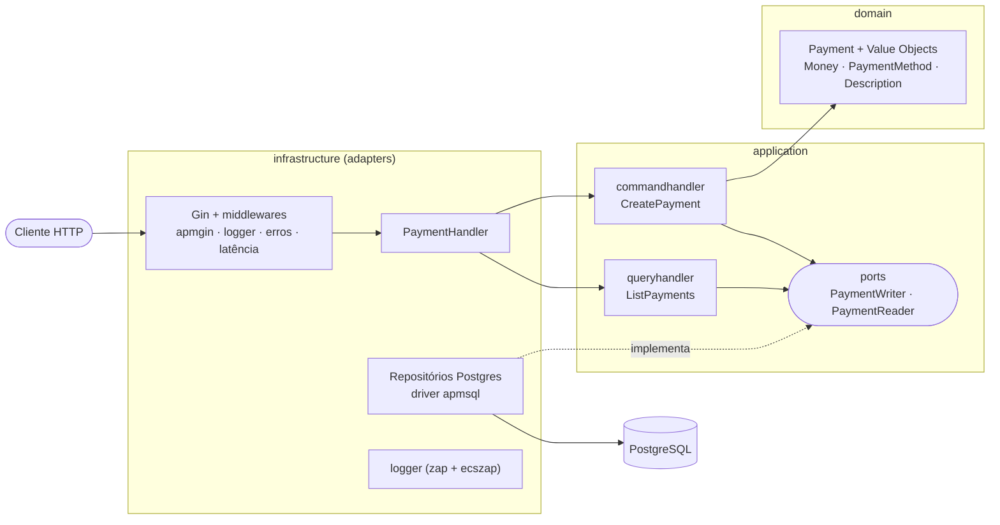
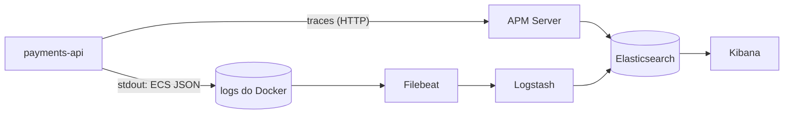

# go-payment-apm

[](https://github.com/EmanuelErnesto/go-payment-apm/actions/workflows/ci.yml)
[](https://goreportcard.com/report/github.com/EmanuelErnesto/go-payment-apm)


API de pagamentos em Go, com **arquitetura hexagonal** e **observabilidade completa no Elastic Stack**:
traces distribuídos no **Elastic APM** e logs estruturados em **ECS** coletados via
**Filebeat → Logstash → Elasticsearch**. Logs e traces são correlacionados pelo `trace.id`,
então dá para ir de uma requisição lenta no APM direto para as linhas de log dela no Kibana.

O projeto tem fins didáticos: inclui um endpoint com um gargalo simulado para mostrar como um
problema de performance aparece no APM. Há uma apresentação do projeto em
[`docs/presentation/go-payment-apm.pptx`](docs/presentation/go-payment-apm.pptx).

## Sumário

- [Funcionalidades](#funcionalidades)
- [Arquitetura](#arquitetura)
- [Requisitos](#requisitos)
- [Início rápido](#início-rápido)
- [Uso da API](#uso-da-api)
- [Observabilidade](#observabilidade)
- [Configuração](#configuração)
- [Desenvolvimento](#desenvolvimento)
- [Estrutura do projeto](#estrutura-do-projeto)
- [Solução de problemas](#solução-de-problemas)
- [Contribuindo](#contribuindo)

## Funcionalidades

- `POST /payments` cria e aprova um pagamento (valor em centavos; `BRL`, `USD` ou `EUR`; `credit_card`, `debit_card`, `pix` ou `boleto`).
- `GET /payments` lista os pagamentos com paginação, mais recentes primeiro.
- `POST /payments/delay` faz o mesmo fluxo da criação, com um atraso intencional registrado como span próprio no APM.
- Swagger UI em `/swagger/index.html`.
- Instrumentação de APM sem código de observabilidade nos handlers: transação HTTP via middleware e queries SQL via driver instrumentado.
- Logs JSON no padrão ECS com `trace.id`, `transaction.id` e `span.id` em toda linha da requisição.
- Hardening HTTP: headers de segurança, limite de 64 KiB no body (resposta 413), rejeição de campos desconhecidos (proteção contra mass assignment) e erros internos que nunca vazam detalhes ao cliente.

## Arquitetura

O código segue **Ports & Adapters** (arquitetura hexagonal), com escrita e leitura separadas (CQRS).
As dependências apontam sempre para dentro, e o domínio não conhece HTTP, banco nem APM.



Fluxo de observabilidade:



A aplicação **só escreve em stdout**: ela não conhece o Logstash. Quem coleta e entrega os logs é a
plataforma (Filebeat), com entrega garantida e backpressure, sem acrescentar latência às requisições.

**Stack:** Go 1.27 · Gin · PostgreSQL 17 · Elastic APM Go Agent v2 · zap/ecszap · Elastic Stack 9.5
(Elasticsearch, Kibana, APM Server, Logstash, Filebeat) · golang-migrate · swag · gomock.

## Requisitos

| Para                    | Precisa de                                              |
|-------------------------|---------------------------------------------------------|
| Rodar a stack completa  | Docker com Compose v2 e buildx, com **≥ 6 GiB de RAM** para o Docker |
| Desenvolver localmente  | [mise](https://mise.jdx.dev) (instala Go, migrate, air e swag) e GNU make |

O setup por sistema operacional, incluindo Windows e Docker via Homebrew/Colima, está no
[CONTRIBUTING.md](CONTRIBUTING.md).

## Início rápido

```bash
git clone https://github.com/EmanuelErnesto/go-payment-apm.git
cd go-payment-apm
make up
```

O `make up` cria o `.env` a partir do `.env.example`, builda a API e sobe Postgres, migrações,
Elastic Stack e a API. A primeira subida leva alguns minutos por causa do download das imagens.

| Serviço        | URL                                      |
|----------------|------------------------------------------|
| API            | http://localhost:8080                    |
| Swagger UI     | http://localhost:8080/swagger/index.html |
| Kibana         | http://localhost:5601                    |
| Elasticsearch  | http://localhost:9200                    |

> Troque as senhas do `.env` antes de usar o ambiente fora da sua máquina. Todas as portas
> ficam presas a `127.0.0.1`, e a segurança do Elasticsearch fica desligada só para dev local.

## Uso da API

Criar um pagamento:

```bash
curl -s -X POST http://localhost:8080/payments \
  -H 'Content-Type: application/json' \
  -d '{"amount_cents":1990,"currency":"BRL","method":"pix","description":"Assinatura mensal"}'
```

```json
{
  "id": "019a7e1c-3b2a-7c3e-9f1d-2a4b6c8d0e1f",
  "amount_cents": 1990,
  "currency": "BRL",
  "method": "pix",
  "status": "approved",
  "description": "Assinatura mensal",
  "created_at": "2026-11-26T14:03:37.246042Z"
}
```

Listar com paginação (`page` ≥ 1; `page_size` de 1 a 100, padrão 10):

```bash
curl -s 'http://localhost:8080/payments?page=1&page_size=5'
```

Criar com o gargalo simulado (`PAYMENT_SIMULATED_DELAY`, 3 s no `.env.example`):

```bash
curl -s -X POST http://localhost:8080/payments/delay \
  -H 'Content-Type: application/json' \
  -d '{"amount_cents":500,"currency":"USD","method":"credit_card"}'
```

| Status | Quando |
|--------|--------|
| `201`  | Pagamento criado |
| `200`  | Listagem |
| `400`  | Body ou query inválidos: valor ≤ 0, moeda ou método fora da lista, descrição com mais de 255 caracteres, campo desconhecido, JSON malformado |
| `413`  | Body maior que 64 KiB |
| `500`  | Falha interna (ex.: banco fora do ar). A resposta é sempre `{"error":"internal server error"}`, e o detalhe vai para o log e para o APM |

O contrato completo está no Swagger UI.

## Observabilidade

Depois de fazer algumas requisições:

- **Traces:** Kibana → *Observability → APM → Services → payments-api*. Cada rota aparece como uma
  transação, com spans das queries SQL. Em `POST /payments/delay`, o span `simulated bottleneck` mostra
  onde o tempo foi gasto.
- **Logs:** Kibana → *Discover*, data view `logs-payments_api-*`. Filtre por `trace.id` para ver todas
  as linhas de uma requisição.
- **Erros:** só falhas reais (5xx) viram erro no APM; erros de validação (4xx) não poluem a aba *Errors*.

Para rastrear uma requisição específica, envie seu próprio trace id no header W3C `traceparent`:

```bash
TRACE_ID=$(openssl rand -hex 16)
curl -s -X POST http://localhost:8080/payments \
  -H "traceparent: 00-${TRACE_ID}-$(openssl rand -hex 8)-01" \
  -H 'Content-Type: application/json' \
  -d '{"amount_cents":700,"currency":"EUR","method":"pix"}'
echo "trace.id: ${TRACE_ID}"
```

Em seguida, procure `trace.id : "<valor>"` no Discover ou no APM.

> O agente de APM descarta, por padrão, spans de banco com menos de 1 ms e só os contabiliza na
> transação. Para ver todas as queries, defina `ELASTIC_APM_EXIT_SPAN_MIN_DURATION=0ms`.

## Configuração

A configuração vem de variáveis de ambiente, lidas **apenas** no ponto de entrada
(`cmd/api/config.go`) e repassadas às camadas por injeção de dependência.

| Variável                   | Padrão                  | Descrição |
|----------------------------|-------------------------|-----------|
| `HTTP_PORT`                | `8080`                  | Porta HTTP |
| `GIN_MODE`                 | `release`               | `debug` ou `release` |
| `SWAGGER_ENABLED`          | `true`                  | Expõe o Swagger UI |
| `PAYMENT_SIMULATED_DELAY`  | `2s`                    | Atraso de `/payments/delay`; deve ser menor que `HTTP_WRITE_TIMEOUT` |
| `HTTP_WRITE_TIMEOUT`       | `30s`                   | Timeout de escrita do servidor |
| `LOG_LEVEL`                | `info`                  | `debug`, `info`, `warn` ou `error` |
| `DB_HOST` / `DB_PORT`      | `localhost` / `5432`    | Endereço do Postgres |
| `DB_NAME`                  | `payments`              | Banco de dados |
| `DB_USER`                  | `payments_app`          | Usuário com privilégio mínimo usado pela API |
| `DB_PASSWORD`              | **obrigatória**         | Senha desse usuário |
| `DB_SSLMODE`               | `disable`               | `sslmode` da conexão |
| `ELASTIC_APM_SERVER_URL`   | `http://localhost:8200` | URL do APM Server |
| `ELASTIC_APM_SERVICE_NAME` | `payments-api`          | Nome do serviço no APM e nos logs |
| `ELASTIC_APM_ENVIRONMENT`  | `local`                 | Ambiente no APM e nos logs |
| `ELASTIC_APM_SECRET_TOKEN` | —                       | Token do APM Server |

O `.env.example` também traz as variáveis usadas só pelo Docker Compose: `POSTGRES_USER`,
`POSTGRES_PASSWORD`, `ELASTIC_VERSION` e `KIBANA_ENCRYPTION_KEY`.

## Desenvolvimento

```bash
make setup       # .env + ferramentas via mise + git hooks (uma vez)
make deps-up     # sobe só Postgres e Elastic Stack
make migrate-up  # aplica as migrações
make run         # API local com hot reload (Air)
```

| Comando          | O que faz |
|------------------|-----------|
| `make test-unit` | Todos os testes unitários, com race detector e ordem aleatória |
| `make cover`     | Relatório de cobertura de domínio e aplicação |
| `make vet`       | Análise estática |
| `make fmt`       | Formata o código (o pre-commit hook roda isso a cada commit) |
| `make fmt-check` | Só verifica a formatação, sem alterar nada (usado no CI) |
| `make mocks`     | Regenera os mocks das ports (gomock) |
| `make swagger`   | Regenera a documentação Swagger |
| `make help`      | Lista todos os comandos |

O CI ([`.github/workflows/ci.yml`](.github/workflows/ci.yml)) roda formatação, `vet`, testes
unitários e build a cada push e pull request para a `main`.

## Estrutura do projeto

```text
.
├── cmd/api/                  # ponto de entrada: config (envs), injeção de dependências, servidor
├── internal/
│   ├── domain/               # entidade Payment e value objects (sem dependências externas)
│   ├── application/
│   │   ├── command/          # comandos e resultados de escrita
│   │   ├── commandhandler/   # caso de uso CreatePayment
│   │   ├── query/            # queries e resultados de leitura
│   │   ├── queryhandler/     # caso de uso ListPayments
│   │   └── port/             # interfaces de persistência (+ mocks)
│   └── infrastructure/
│       ├── httpapi/          # Gin: rotas, handlers, DTOs e middlewares
│       ├── logger/           # zap + ECS + correlação com o APM
│       └── persistence/      # repositórios Postgres
├── migrations/               # migrações SQL (golang-migrate)
├── deploy/                   # configs de APM Server, Filebeat, Logstash e Postgres
├── docs/                     # Swagger gerado
└── docker-compose.yml
```

## Solução de problemas

| Sintoma | Causa e solução |
|---------|-----------------|
| `"" is an invalid OS component` no build | Docker sem o plugin buildx (builder legado). Instale o `docker-buildx`. |
| `docker compose` não é reconhecido | O plugin do Compose não está numa pasta que o Docker CLI procura. Veja o [CONTRIBUTING.md](CONTRIBUTING.md). |
| Elasticsearch reiniciando (exit 137) | Pouca memória para o Docker. Use pelo menos 6 GiB, por exemplo `colima start --memory 8`. |
| `failed to resolve reference ... not found` | `ELASTIC_VERSION` com uma versão que não existe. Use uma versão publicada (padrão: `9.5.6`). |
| Nenhum log no Kibana | Confira `docker compose logs filebeat logstash`. Os logs levam alguns segundos para chegar. |

## Contribuindo

O guia de ambiente por sistema operacional, os git hooks e as convenções estão no
[CONTRIBUTING.md](CONTRIBUTING.md). Os commits seguem
[Conventional Commits](https://www.conventionalcommits.org/).
